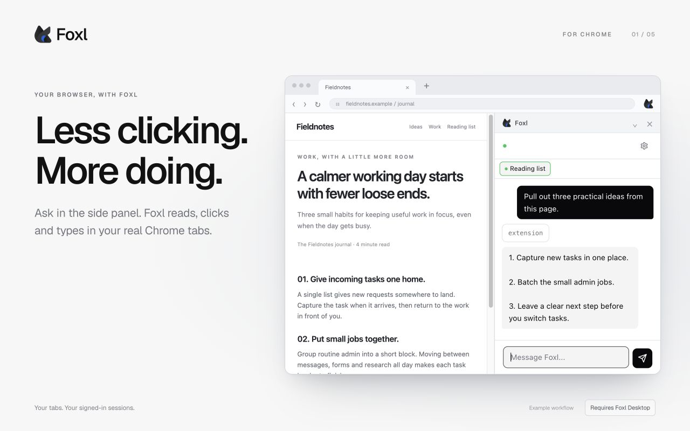
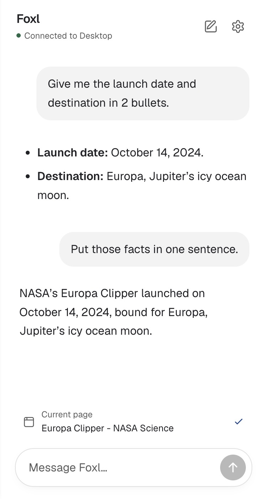
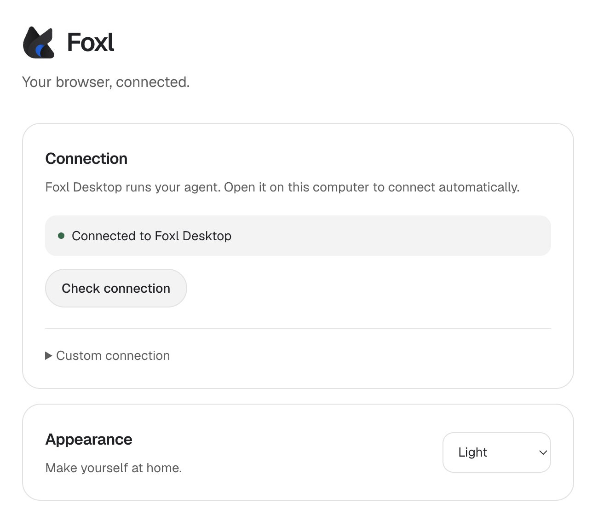
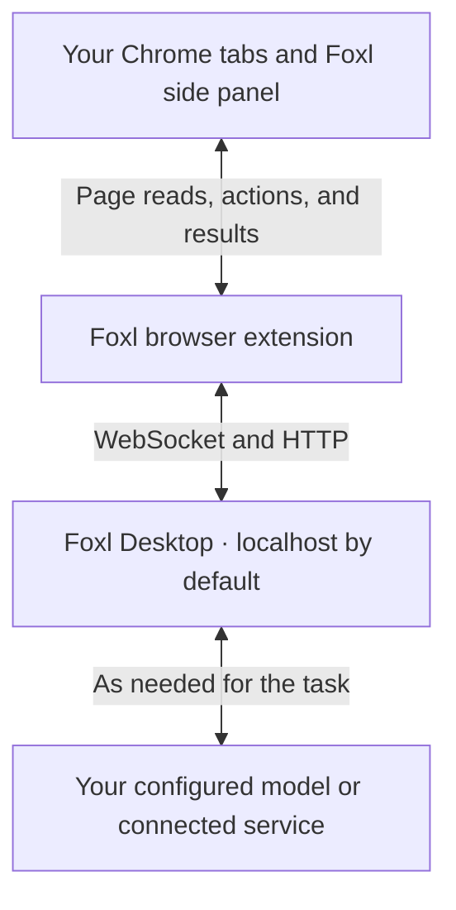

<p align="center">
  <a href="https://foxl.ai"></a>
</p>

<h1 align="center">Foxl Browser Extension</h1>

<p align="center">
  <strong>A little less busywork.</strong><br />
  Read, ask, and get things done in the Chrome tabs you already use.<br />
  Your Foxl Desktop agent, right beside the page.
</p>

<p align="center">
  <a href="https://chromewebstore.google.com/detail/foxl/ijlihobebaeangjiacfomjdkhlpbmlhi"><strong>Add to Chrome</strong></a> &nbsp;·&nbsp;
  <a href="#get-started">Get started</a> &nbsp;·&nbsp;
  <a href="#permissions">Permissions</a> &nbsp;·&nbsp;
  <a href="docs/DEVELOPMENT.md">Developer guide</a> &nbsp;·&nbsp;
  <a href="LICENSE">License</a>
</p>

<p align="center">
  <a href="store/screenshots/en/01-browser.png"></a>
</p>

**Requires Foxl Desktop.** The desktop app runs the agent and connects to the model
you choose. This extension lets it read pages, follow links, fill forms, and move
between tabs in your existing browser session. Keep both running on the same
computer for the default setup.

The 0.10.0 redesign brings readable 16px conversation text, a rounded message bar,
editable starting prompts, and a simpler settings page. Follow-up questions keep
the recent conversation in context.

## Keep the conversation beside the page

Ask for the useful details, then ask the next question. The **Current page**
control shows which page's title and URL will accompany your message; click it
to exclude them. **New chat** clears the visible conversation.

<p align="center">
  <a href="assets/readme/conversation-light.png"></a>
</p>

These images come from the loaded extension connected to Foxl Desktop. The
messages and results are real. See the [five-image gallery](store/screenshots/en/)
and [capture provenance](store/source/captures/provenance.json).

## Get started

You need **Chrome 116 or newer** and [Foxl Desktop](https://github.com/foxl-ai/foxl#get-started).

1. **Install the extension** from the [Chrome Web Store][chrome-store].
2. **Open Foxl Desktop.** The extension discovers the local app automatically.
3. **Open the Foxl side panel** from Chrome's toolbar and check the connection status.
4. **Start with a small task.** Open a page and ask Foxl to help with it.

> “Summarize this page and list the questions I should ask next.”

Press **Enter** to send and **Shift+Enter** for a new line. Starting prompts fill
the message bar so you can edit the request before sending.

The store installation updates through Chrome. The extension ID is `ijlihobebaeangjiacfomjdkhlpbmlhi`.

### Make yourself at home

Open **Settings** from the panel to check the Desktop connection, choose Light,
Dark, or System appearance, and see the keyboard shortcut Chrome assigned.
Automatic connection is the default; a custom server URL is optional.

<p align="center">
  <a href="assets/readme/settings-light.png"></a>
</p>

### Install from source instead

The checkout can be loaded directly; no build or dependency installation is needed.

```sh
git clone https://github.com/foxl-ai/browser-extension.git
```

Open `chrome://extensions`, turn on **Developer mode**, select **Load unpacked**, and choose the cloned `browser-extension` directory. Reload the extension from that page after changing its source.

The extension targets Chrome. Other Chromium browsers may work, but these instructions and the store link are for Chrome.

## The ideas behind the extension

**Work where you already are.** Your open tabs, familiar websites, and existing sessions stay part of the task. The side panel keeps the conversation beside the page.

**Make access understandable.** Every requested permission is documented below and tied to its use in the source. A small codebase and a dependency-free runtime make inspection practical.

**Keep the connection visible.** Connection status and page indicators help you
follow the work. Chrome's site-access settings let you choose which sites the
extension can use.

**Make the package reproducible.** The build script uses an explicit file list, stable ordering, and fixed timestamps. You can rebuild the archive and compare it with another build.

## How it works



The content script turns a page into a compact tree of labelled elements. The agent can refer to those elements when it clicks or types:

```text
navigation [ref_1]
  link "Products" [ref_2] href="/products"
  link "About" [ref_3] href="/about"
textbox "Search" [ref_4] placeholder="Search..."
button "Sign in" [ref_5]
```

Screenshots capture a background tab without selecting it, including a chosen rectangle or the full document. On a compatible desktop, snapshots can return just the changes since a previously read snapshot. A service worker handles the desktop connection, tab management, and command dispatch; content scripts carry out page actions and display activity indicators.

## Where your data goes

**By default, extension traffic goes to Foxl on your computer.** It discovers `http://localhost:13847`, with `http://localhost:3847` as the fallback. The options page can override that server URL; a custom endpoint changes where extension data is sent.

Page text, screenshots, tab URLs and titles, and chat requests can pass to that configured server. Foxl Desktop may then send task context to your chosen model provider or connected service. Local transport between Chrome and Desktop does not mean every part of the task stays on your computer.

The extension has no analytics endpoint, remote configuration, or remotely hosted
executable code. Connection and appearance settings are stored in
`chrome.storage.local`. The visible conversation stays in the panel's memory;
New chat or closing the panel clears it. Follow-up requests include recent
messages, including information already shared before you excluded the current page.

The network entry points are small enough to inspect directly:

| Source | Requests |
| :--- | :--- |
| [Service worker](src/service-worker.js) | Health probes at `/api/health`, a WebSocket at `/extension`, and chat requests at `/api/chat` |

The settings page asks the service worker for its actual connection status.

```sh
rg -n 'fetch\(|XMLHttpRequest|new WebSocket|navigator.sendBeacon' src/
node scripts/audit.mjs
```

[Extension privacy details](PRIVACY.md) · [Foxl privacy policy](https://foxl.ai/privacy) · [Report a security issue](SECURITY.md)

## Permissions

The manifest requests access to all sites so the agent can work on the pages you choose. You can restrict **Site access** in the extension's Chrome settings.

| Permission | What it enables |
| :--- | :--- |
| `<all_urls>` | Read and interact with the pages you allow. |
| `tabs` | Read tab titles and URLs, navigate, and open, switch, or close tabs. |
| `scripting` | Read snapshots, scroll, and check the target page's current site access before and after a screenshot. |
| `debugger` | Briefly attach to a background tab to read its viewport and capture its pixels without selecting it. |
| `tabGroups` | Organize tabs opened for agent tasks. |
| `sidePanel` | Show the conversation beside the current page. |
| `storage` | Save connection and appearance settings locally. |
| `alarms` | Maintain the service worker's connection lifecycle. |

Version 0.10.0 requests the same permissions as 0.9.0. If you are upgrading from
0.8.x or earlier, Chrome asks you to accept the `debugger` permission introduced
in 0.9 ("Access the page debugger backend"). If Foxl is disabled after updating,
open Chrome's menu and choose "Foxl is disabled", or re-enable it in
`chrome://extensions` and review the permission prompt.

While Foxl captures a background tab, or draws one after scrolling it, Chrome shows a bar at the top of every tab in every window: "Foxl" started debugging this browser, with a Cancel button. The bar shortens the page you are viewing and closes 5 seconds after the last capture. The tab you are looking at is captured without the debugger. The API has broad capabilities; this extension uses only `Page.getLayoutMetrics` and `Page.captureScreenshot`, checks site access with `scripting` before attaching and before returning pixels, and detaches after each capture. It exposes no arbitrary CDP command, cookie reader, or network recorder. Where Chrome refuses the debugger (an administrator's DevTools policy, a page containing another extension's frame) or cannot draw a background tab (a PDF), a screenshot selects the tab for a moment and switches back, as 0.8 did. Without site access, a screenshot fails.

[manifest.json](manifest.json) declares the permissions. [scripts/audit.mjs](scripts/audit.mjs) checks permission usage and the network and executable-code surface in CI.

## Find your way around

| Path | Purpose |
| :--- | :--- |
| [src/service-worker.js](src/service-worker.js) | Connection, tabs, and command routing |
| [src/input-queue.js](src/input-queue.js) | One click / type / key at a time per tab, each with a deadline |
| [src/page-capture.js](src/page-capture.js) | Background screenshots, page-access checks, and CSS geometry |
| [src/page-snapshot.js](src/page-snapshot.js) | Bounded snapshots and explicit baselines for changes |
| [src/content-scripts/](src/content-scripts/) | Page accessibility tree and visual indicators |
| [src/sidepanel.js](src/sidepanel.js) · [sidepanel.html](sidepanel.html) | Side panel conversation |
| [src/panel-context.js](src/panel-context.js) | Current-window page selection and bounded conversation context |
| [src/message-text.js](src/message-text.js) | Safe rendering of message paragraphs, lists, code, and links |
| [src/theme.js](src/theme.js) · [styles/foxl.css](styles/foxl.css) | Shared Foxl typography, colors, and appearance |
| [src/options.js](src/options.js) · [options.html](options.html) | Appearance, connection checks, and shortcuts |
| [scripts/](scripts/) | Source audit, unit tests, reproducible packaging, and icon generation |
| [store/](store/) | Real store captures, artwork, and review evidence |
| [CHANGELOG.md](CHANGELOG.md) | Version history |

## Develop and contribute

Use **Node.js 20 or newer** for the audit and package build:

```sh
node scripts/audit.mjs
node --test scripts/*.test.mjs
node scripts/build.mjs
```

The build writes versioned and `latest` ZIPs plus `SHA256SUMS.txt` to `dist/`. Dependencies are needed only if you want to regenerate the PNG icons.

The [developer guide](docs/DEVELOPMENT.md) covers debugging, package comparison,
and releases. For a change, open a pull request with the problem, the resulting
behavior, and how you verified it. CI checks the audit, unit tests, reproducible
build, and manifest/changelog agreement. The [0.10.0 review record](store/QUALITY.md)
also covers real Desktop tasks and visual checks.

## Help and license

[Report a bug or suggest an improvement](https://github.com/foxl-ai/browser-extension/issues). Include the extension version, Chrome version, operating system, and reproduction steps.

Report vulnerabilities privately to [security@foxl.ai](mailto:security@foxl.ai); see [SECURITY.md](SECURITY.md).

Licensed under [Apache-2.0](LICENSE). See [NOTICE](NOTICE) for attribution.

<p align="center"><sub>Part of <a href="https://foxl.ai">Foxl</a> · Your day. A little lighter.</sub></p>

[chrome-store]: https://chromewebstore.google.com/detail/foxl/ijlihobebaeangjiacfomjdkhlpbmlhi
